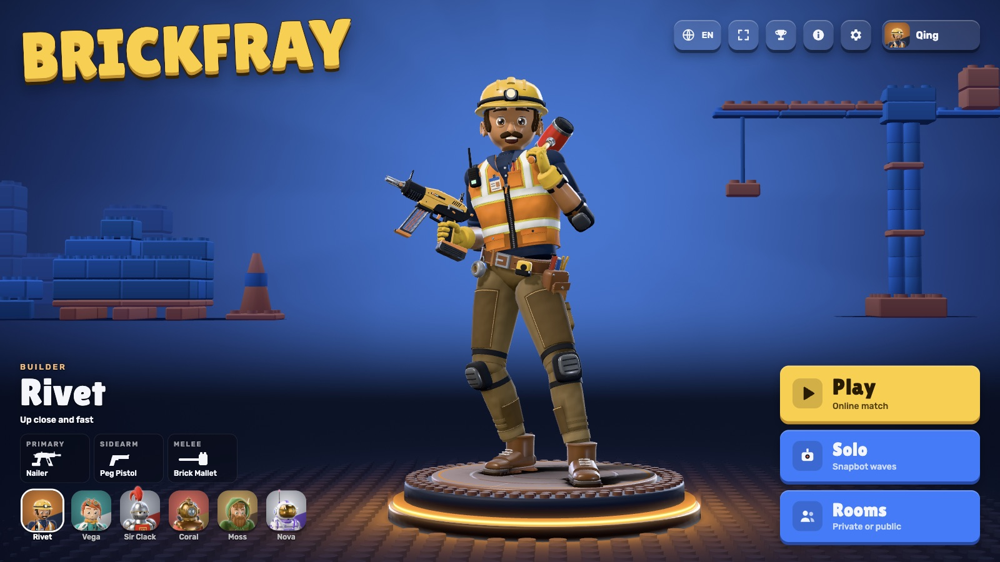
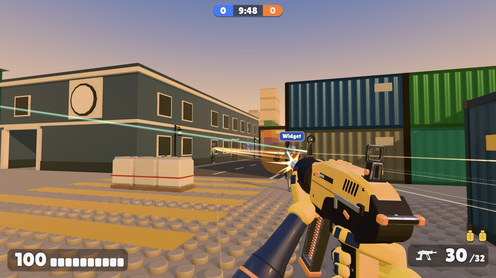
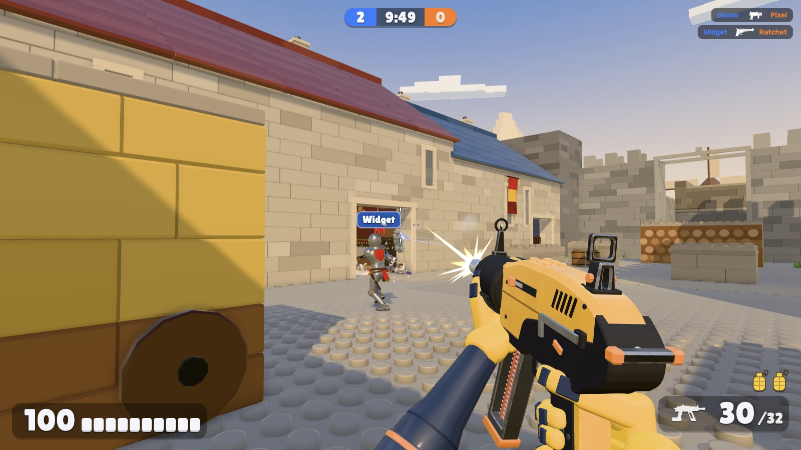
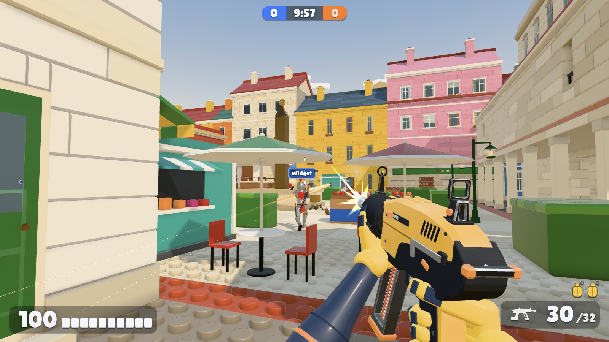
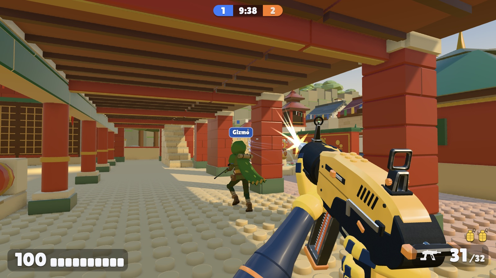
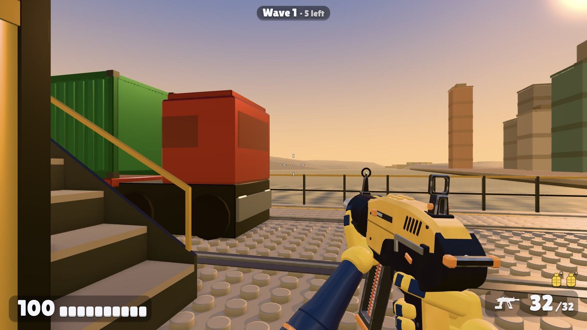
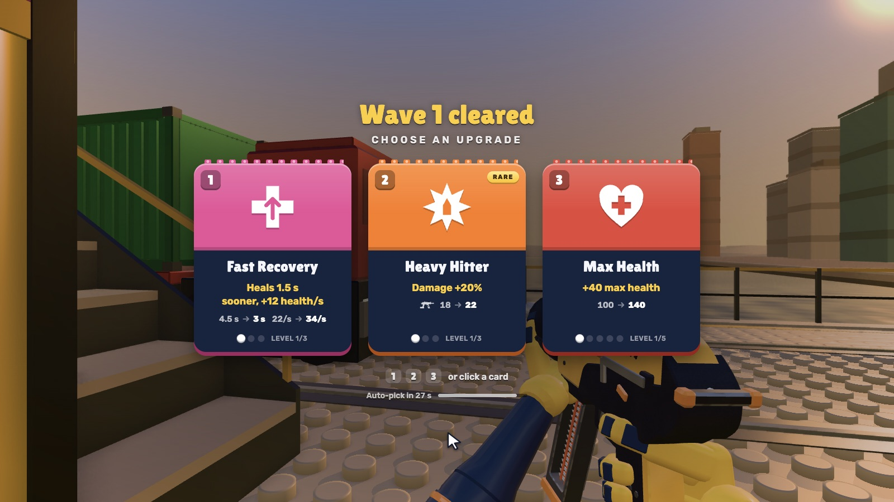
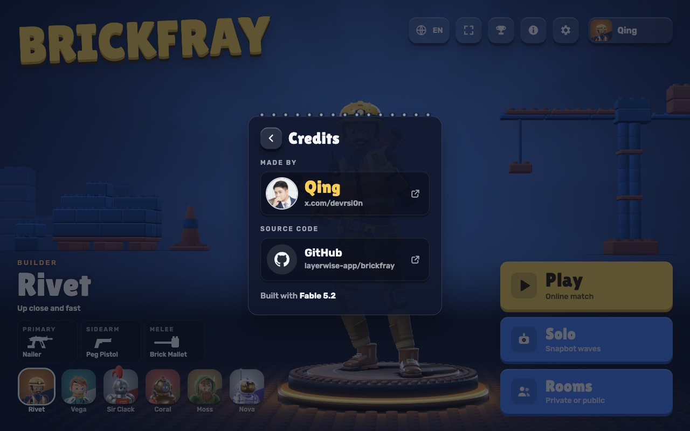

# Brickfray

**A fast, colorful first-person shooter built from toy bricks. It runs in the browser with nothing to install.**

[Play now](https://brickfray.layerwise.site) · [Source](https://github.com/layerwise-app/brickfray) · [License: AGPL-3.0](LICENSE)



Brickfray is an original arena shooter: six brick-built heroes, four maps, online matches for up to ten players, and a solo wave mode against Snapbots. Rooms are hosted peer to peer in the browser, so a match needs no game server. It runs on desktop with a mouse, keyboard or gamepad, and on phones and tablets with touch controls.

## Gameplay

| | |
| --- | --- |
|  |  |
| **Docks**: container yards, a customs hall and a cargo ship on a working harbor | **Fortress**: a hilltop castle and its village, with walls, gates and courtyards |
|  |  |
| **Plaza**: a town square of cafés, gardens and arcades | **Temple**: covered colonnades and courtyards around a mountain temple |

### Modes

- **Free-for-all**: everyone for themselves.
- **Team deathmatch**: two equal teams. The host sets the team size and the time limit.
- **Waves (solo)**: hold out against Snapbot waves on Easy, Normal or Hard. Each cleared wave offers a choice of three upgrades, and Megabot boss waves arrive along the way.

Empty seats in online matches fill with bots. Bots only act on what they can see and hear: line of sight, a view cone, reaction time, and the rough direction of footsteps and gunfire.

| | |
| --- | --- |
|  |  |

### Heroes

Each hero has a fixed loadout: a primary, a sidearm, a melee weapon and grenades.

| Hero | Role | Primary | Sidearm | Melee |
| --- | --- | --- | --- | --- |
| Rivet | Builder | Nailer | Peg Pistol | Brick Mallet |
| Vega | Scout | Clicker AR | Peg Pistol | Snap Knife |
| Sir Clack | Knight | Snapgun | Hand Cannon | Brick Blade |
| Coral | Diver | Harpooner | Buzzer | Anchor |
| Moss | Ranger | Longstud | Buzzer | Hatchet |
| Nova | Astronaut | Pulse Carbine | Peg Pistol | Torque Wrench |

### More

- Kill chains up to five, a voiced announcer, medals and achievements.
- Leaderboards and player profiles.
- Seven languages: English, 中文, Español, Français, Deutsch, 日本語 and 한국어.
- Three quality tiers. Each tier sets resolution first, then shadows and effects. An optional auto-resolution mode holds the frame rate.

## Controls

| Action | Keyboard and mouse |
| --- | --- |
| Move | W A S D |
| Jump / crouch / sprint | Space / C / Left Shift |
| Fire / aim | Left / right mouse button |
| Reload / melee / grenade | R / F / G |
| Switch weapon | 1 / 2 |
| Scoreboard / chat | Tab / Enter |
| Pause | Esc |

Every binding can be changed in Settings. Gamepads work out of the box, and phones and tablets get on-screen touch controls.

Brickfray plays best in Chrome or another Chromium browser. In fullscreen there, Esc only pauses the match, and browser shortcuts such as Ctrl+W can't close the tab mid-fight.

## Technology

- **Rendering**: [Three.js](https://threejs.org) with a custom plastic material, instanced studs and bricks, baked ambient occlusion and level of detail for distant scenery.
- **Simulation**: a deterministic fixed-step simulation shared by host and clients, covering movement, collision, hitscan and projectile combat, and hitbox rewind for lag compensation.
- **Networking**: host-authoritative rooms over WebRTC data channels via [PeerJS](https://peerjs.com). Clients use prediction, reconciliation and interpolation. Snapshots are quantized and delta-compressed.
- **Audio**: a Web Audio mixer with positional sound, per-map reverb, distance filtering and voice limiting.
- **App**: React 19 and [TanStack Start](https://tanstack.com/start) on Cloudflare Workers, with D1 and Drizzle for accounts, leaderboards and achievements, and Better Auth for sign-in.

### Project layout

```
src/
  brickfray/
    engine/      renderer, materials, quality tiers, resolution scaling
    world/       the four maps, scenery and backdrops
    characters/  hero models and animation
    weapons/     weapon definitions, loadouts and view models
    sim/         shared simulation: movement, combat, bots, waves, match rules
    net/         rooms, protocol, host and client sessions
    game/        game loop, input, camera, match view
    audio/       mixer, positional audio, music and announcer
    fx/          impacts, debris and other effects
    ui/          menus, HUD, settings and translations
    lab/         development scenes for maps and weapons
  routes/        app pages and API routes (leaderboards, auth)
  db/            database schema
public/          audio, hero models and map art
```

## Development

Requires Node.js and pnpm.

```sh
pnpm install
pnpm dev            # start the dev server
pnpm test           # run the test suite (Vitest)
pnpm check-types    # TypeScript
pnpm build          # production build
```

In development, `/lab` opens test scenes for every map and weapon, with fixed cameras, targets and simulation telemetry. The route is not available in production builds.

## Credits

Made by [Qing](https://x.com/devrsi0n), built with Fable 5.2 on [Layerwise](https://layerwise.app).



Every sound is cut from recordings released under CC0 1.0 or dedicated to the public domain: BigSoundBank, Kenney, OpenGameArt, Freesound, The Free Firearm Sound Library and VSCO 2 Community Edition. The music was composed for Brickfray from single recorded notes of real instruments. Sources for every file are listed in `public/audio/CREDITS-*.md`.

Brickfray is an original game. It is not affiliated with or endorsed by any toy brick manufacturer.

## License

Copyright © 2026 Qing.

Brickfray's source code is licensed under the [GNU Affero General Public License v3.0](LICENSE). You may use, modify and share it. If you run a modified version as a network service, you must offer its players the source of that version under the same license.

The audio in `public/audio/` keeps its original CC0 1.0 or public-domain status, as listed in the credits files.
